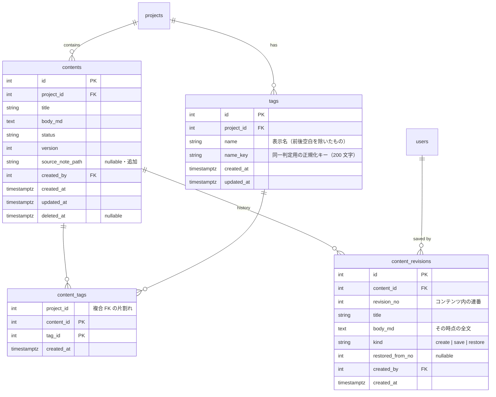
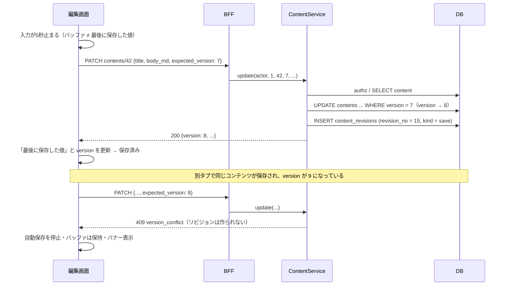
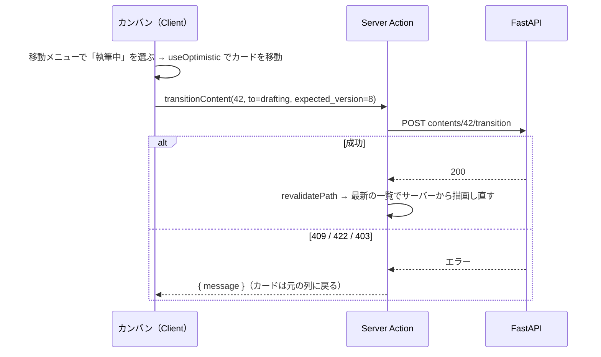

# design.md — content-pipeline（ネタ管理・執筆）

> **前提**：`requirements.md`（レビュー待ち）、foundation の design.md（認可・楽観ロック・エラー体系・テスト分離はそのまま使う）、
> ADR-0015（データフェッチ層の判断をこのスペックへ持ち越し）、ADR-0016（エディタ＝CodeMirror 6・提案）。
> **このドキュメントの範囲**：M1 のうちエディタ（30h）とタグ・カンバン（10h）。`requirements.md` §8 の未決事項をここで解消する。

---

## 1. 設計の狙い

1. **本文の正は `contents.body_md` の文字列1つ** — エディタ・リビジョン・MCP・公開が同じ文字列を見る。変換を挟まない（ADR-0016）
2. **foundation の骨格に足すだけ** — 認可（`ProjectAuthorizer`）・楽観ロック（二段構え）・エラー封筒・テスト分離を作り直さない。新しい Permission も足さない（§5）
3. **企画をまたぐ参照を DB で止める** — 「他企画のタグを付ける」を Service の確認だけに頼らず、複合 FK で物理的に作れなくする（§3-3）
4. **プッシュが来る画面だけ、フェッチ層のキャッシュに寄せる** — M2 の編集ロックが届くのは編集画面。そこにだけデータフェッチ層を入れ、採否はスパイクで確かめてから決める（§9-1）

---

## 2. モジュール構成

**新しいモジュールは作らず、`modules/contents` に足す。**

```
backend/app/modules/contents/
├── models.py       Content（+ source_note_path）/ ContentStatusTransition / Tag / ContentTag / ContentRevision
├── repository.py   ContentRepository（絞り込み追加）/ ContentTransitionRepository / TagRepository / RevisionRepository
├── service.py      ContentService（更新時にリビジョンを書く・復元・タグ付け）/ TagService
├── schemas.py
├── router.py       contents / tags / revisions の3ルーター
└── deps.py
```

| 判断 | 理由 |
|---|---|
| タグを `modules/tags` に分けない | タグの用途は「コンテンツに付ける」ことだけで、付け外しはコンテンツの更新と同じ認可（`CONTENT_WRITE`）で行う。分けると `contents.repository` が `tags.models` を import する依存が生まれ、`content_tags` の持ち主も曖昧になる |
| リビジョンを分けない | **リビジョンの作成は本文更新と同じトランザクションの中で起きる**（§6-2）。モジュールを分けると Service 同士の呼び出しになり、どちらが commit 境界を持つかの議論が増えるだけ |
| `.importlinter` | 既存の `app.modules.contents` コンテナに乗るので契約の変更は無い |

> `service.py` が大きくなりすぎたら（目安 500 行）、そのときにモジュールを割る。M1 で先回りしない（Completion over Perfection）。

---

## 3. データモデル

### 3-1. ER 図（このスペックで足す部分）



### 3-2. 補足

| 項目 | 決定 | 理由 |
|---|---|---|
| `source_note_path` | `contents` の列（`VARCHAR(500)` nullable） | 1コンテンツに元ノートは1つ（`requirements-overview` §8 の前提どおり）。別テーブルにする理由が無い |
| タグ名の同一判定 | `name_key = NFKC 正規化 → casefold → 前後空白除去`。`UNIQUE (project_id, name_key)` | 「Python」と「python」、全角「ＡＷＳ」と「AWS」を別タグにしない。表示は入力どおりの `name` を残す |
| タグ名の長さ | 表示名は 1〜50 文字。`name_key` の列は 200 文字 | Qiita のタグも短い。`name_key` を長く取るのは、NFKC で文字が増えることがあるため（「㍿」→「株式会社」） |
| 1コンテンツのタグ数 | 上限 10 | 絞り込みと表示が破綻しない程度。Qiita のタグ上限（5）より多めに取る |
| タグの削除 | **物理削除**。`content_tags` は `ON DELETE CASCADE` | タグは履歴を持たない。リビジョンにもタグは含めない（C7） |
| リビジョンの持ち方 | **全文スナップショット** | 閲覧も復元も1行読めば済む。差分方式は「途中が壊れると以降すべて復元できない」と「復元のたびに差分を順に当てる」の2つを抱える。容量は PostgreSQL が長いテキストを自動で圧縮して別領域に置く（TOAST）ので、全文でも見た目ほど膨らまない |
| `revision_no` | コンテンツ内の連番。`UNIQUE (content_id, revision_no)` | URL に出す番号（`.../revisions/12`）。`id` を出すと他コンテンツの件数が透けるうえ、「何版目か」が分からない |
| `kind` | `create`（作成時の初版）/ `save`（自動・手動保存）/ `restore`（復元） | 一覧で「どこで復元したか」が分かるように。`restore` のときは `restored_from_no` に元の版番号を入れる |
| 初版 | **作成時に `revision_no = 1` を1件作る**（`kind = create`） | 最初の保存の前の状態に戻れないと、「書き直したら元のメモが消えた」が起きる |
| 既存データ | マイグレーションで、既存の全コンテンツに初版を1件ずつ作る | 初版が無いコンテンツを作らない（復元 UI に例外ケースを持ち込まない） |
| `content_revisions` の削除 | 持たない（追記専用）。コンテンツの論理削除では消さない | C7「更新・削除の API を持たない」 |

### 3-3. 企画をまたぐタグ付けを DB で止める（複合 FK）

`content_tags` に `project_id` を持たせ、**コンテンツとタグの両方へ `(id, project_id)` の組で FK を張る。**

```sql
-- 参照先にする組を一意にしておく（id が PK なので値としては冗長だが、FK の参照先には UNIQUE が要る）
ALTER TABLE contents ADD CONSTRAINT uq_contents_id_project UNIQUE (id, project_id);
ALTER TABLE tags     ADD CONSTRAINT uq_tags_id_project     UNIQUE (id, project_id);

CREATE TABLE content_tags (
    project_id int NOT NULL,
    content_id int NOT NULL,
    tag_id     int NOT NULL,
    created_at timestamptz NOT NULL DEFAULT now(),
    PRIMARY KEY (content_id, tag_id),
    FOREIGN KEY (content_id, project_id) REFERENCES contents (id, project_id) ON DELETE CASCADE,
    FOREIGN KEY (tag_id,     project_id) REFERENCES tags     (id, project_id) ON DELETE CASCADE
);
CREATE INDEX ix_content_tags_tag_id ON content_tags (tag_id);   -- タグ→コンテンツの絞り込みと、タグ削除時の CASCADE 用
```

- **1行の `project_id` が両方の FK に効くので、コンテンツとタグの企画が違う行はそもそも INSERT できない**（C1「別の企画のタグを付けられない」）
- Service でも事前に確かめる（§6-4）。DB の制約は**最後の砦**で、通常は Service が分かりやすい 422 を返す
- 中間テーブル名 `content_tags` は structure.md の命名規則どおり

### 3-4. インデックス

| インデックス | 用途 |
|---|---|
| `contents (project_id, status)` | 既存。カンバンの主経路 |
| `content_tags (tag_id)` | タグでの絞り込み・タグ削除時の CASCADE |
| `tags (project_id, name_key)` UNIQUE | 同名チェックとタグ一覧 |
| `content_revisions (content_id, revision_no)` UNIQUE | 版の一覧（新しい順）と単体取得 |

**キーワード検索用のインデックスは張らない**（§6-5）。

---

## 4. 楽観ロックとリビジョンの関係

foundation §3-3 の二段構えはそのまま使う。このスペックで決めるのは、**何が `version` を進め、何がリビジョンを作るか**。

| 操作 | `version` | リビジョン | 備考 |
|---|:---:|:---:|---|
| タイトル・本文の保存（値が変わった） | +1 | **1件** | C7 |
| タイトル・本文の保存（値が同じ） | 据え置き | 作らない | foundation §3-3 の挙動そのまま。C6「変わっていない保存は version を進めない」 |
| 復元 | +1 | **1件**（`kind = restore`） | 復元先が現在と同じ内容なら、何もしない（`version` もリビジョンも据え置き） |
| `source_note_path` の変更 | +1 | 作らない | `contents` の列なので `version_id_col` が進む。リビジョンには入れない（C7） |
| 状態遷移 | +1 | 作らない | foundation のまま |
| タグの付け外し | **据え置き** | 作らない | 別テーブル（`content_tags`）の更新なので `contents` は dirty にならない。§6-4 |

### `source_note_path` で `version` が進むことの影響

編集画面でパスを変えると `version` が進み、**同じ画面で開いているエディタの次の自動保存が 409 になる**。
これを避けるため、編集画面ではパスの保存とエディタの保存を**同じ `version` の流れに乗せる**（レスポンスで返った新しい `version` をエディタ側にも反映する。§9-4）。
別のタブ・別の人が変えた場合は 409 になるが、それは正しい検出。

---

## 5. 認可

**新しい Permission は足さない。** `requirements.md` §4 の表は既存の2つで覆える。

| 操作 | Permission |
|---|---|
| 一覧・絞り込み・タグの閲覧・リビジョンの一覧と閲覧 | `CONTENT_VIEW` |
| タグの作成・改名・削除、タグの付け外し、本文の保存、復元、`source_note_path` の変更 | `CONTENT_WRITE` |
| カンバンからの状態遷移 | `CONTENT_TRANSITION`（既存 API をそのまま使う） |

- reviewer がリビジョンを読めるのは `CONTENT_VIEW` に含まれるから。`collaboration` で「前の版と比べる」に使う
- demo は foundation §5-2 の `VIEW_ONLY` 積集合でそのまま閲覧のみになる
- **タグの作成を `CONTENT_WRITE` に相乗りさせる**のは、タグがコンテンツに付けるためだけに存在するから。「タグは作れるがコンテンツは書けない」ロールは要件に無い

すべての Service メソッドの最初の一文で `authz.require(...)` を呼ぶ（foundation §5-4 と同じ形）。

---

## 6. バックエンド設計

### 6-1. API 一覧（追加・変更分）

| メソッド | パス | 権限 | 説明 |
|---|---|---|---|
| GET | `/projects/{id}/contents` | VIEW | **変更**：`tag`（複数可）・`status`（複数可）・`q` を受ける。各要素に `tags` を含める |
| POST | `/projects/{id}/contents` | WRITE | **変更**：`tag_ids` / `source_note_path` を受ける。初版リビジョンを作る |
| GET | `/projects/{id}/contents/{cid}` | VIEW | **変更**：`tags` / `source_note_path` を含める |
| PATCH | `/projects/{id}/contents/{cid}` | WRITE | **変更**：`source_note_path` を受ける（`null` で消す）。本文が変われば リビジョンを作る |
| PUT | `/projects/{id}/contents/{cid}/tags` | WRITE | タグの付け替え（集合で置き換え）。`{ "tag_ids": [1, 3] }` |
| GET | `/projects/{id}/contents/{cid}/revisions` | VIEW | 版の一覧（新しい順・本文なし）。`?before={revision_no}&limit=50` |
| GET | `/projects/{id}/contents/{cid}/revisions/{no}` | VIEW | 版の全文 |
| POST | `/projects/{id}/contents/{cid}/revisions/{no}/restore` | WRITE | 復元。`{ "expected_version": 12 }` |
| GET | `/projects/{id}/tags` | VIEW | タグ一覧（名前順・各タグの使用件数付き） |
| POST | `/projects/{id}/tags` | WRITE | タグ作成 `{ "name": "Python" }` |
| PATCH | `/projects/{id}/tags/{tag_id}` | WRITE | 改名 |
| DELETE | `/projects/{id}/tags/{tag_id}` | WRITE | 削除（付与も外れる） |

- パスに必ず `project_id` を持たせる方針（foundation §6-1）を守る。リビジョンもタグもコンテンツ／企画の下にぶら下げる
- 一覧のレスポンス（`ContentListItem`）は**本文を含めない**まま（C3）。`tags: [{id, name}]` を足す
- リビジョン一覧は `body_md` を返さず、代わりに `body_length`（文字数）を返す。一覧で「どの版で大きく書き足したか」が分かる程度の情報

### 6-2. 本文の保存とリビジョン作成（`ContentService.update`）

```python
async def update(self, actor, project_id, content_id, expected_version, *,
                 title=None, body_md=None, source_note_path=UNSET) -> Content:
    await self._authz.require(actor, project_id, Permission.CONTENT_WRITE)
    content = await self._get_or_404(content_id, project_id)
    self._check_version(content, expected_version)

    body_changed = (title is not None and title != content.title) or \
                   (body_md is not None and body_md != content.body_md)
    if title is not None:   content.title = title
    if body_md is not None: content.body_md = body_md
    if source_note_path is not UNSET:
        content.source_note_path = source_note_path       # schemas 側で検証済み（§6-6）

    await self._contents.flush()                          # ← version +1 と競合検出（409）はここ
    if body_changed:
        await self._revisions.append(content, kind=RevisionKind.SAVE, actor_user_id=actor.user_id)
    return content
```

- **リビジョンの INSERT は、`contents` の flush が通った後に行う。** 楽観ロックに負けた保存（409）はリビジョンを残さない
- 同じトランザクションの中なので、`contents` の更新とリビジョンは**両方残るか、両方残らないか**のどちらか
- `revision_no` は `SELECT COALESCE(MAX(revision_no), 0) + 1 ... WHERE content_id = ?` で決める。
  **同じコンテンツへの並行保存は `contents` の楽観ロックで先に1つに絞られる**ので、ここで競合は起きない。
  万一すり抜けても `UNIQUE (content_id, revision_no)` が落とす（→ 409 にマッピング）
- `source_note_path` は「省略」と「`null`（消す）」を区別する必要がある。Router で Pydantic の `model_fields_set` を見て、送られていなければ `UNSET` を渡す

### 6-3. 復元（`ContentService.restore`）

```python
async def restore(self, actor, project_id, content_id, revision_no, expected_version) -> Content:
    await self._authz.require(actor, project_id, Permission.CONTENT_WRITE)
    content = await self._get_or_404(content_id, project_id)
    self._check_version(content, expected_version)
    rev = await self._revisions.get(content.id, revision_no)        # 無ければ 404
    if (rev.title, rev.body_md) == (content.title, content.body_md):
        return content                                              # 何も変わらない（§4）
    content.title, content.body_md = rev.title, rev.body_md
    await self._contents.flush()
    await self._revisions.append(content, kind=RevisionKind.RESTORE,
                                 restored_from_no=rev.revision_no, actor_user_id=actor.user_id)
    return content
```

- **履歴は巻き戻さない。** 「12版を復元」は「12版の内容で13版を作る」こと（C7）。復元を取り消したくなったら、復元直前の版をもう一度復元すればよい
- 復元も `expected_version` を取る。開いていた画面が古ければ 409（C7）

### 6-4. タグ

**作成・改名**（`TagService`）

- 名前は前後空白を除いて 1〜50 文字。`name_key` は §3-2 の正規化
- 同名（`name_key` が一致）があれば **409**（`error.code = "tag_name_conflict"`）。**事前の確認はせず、UNIQUE 違反を SAVEPOINT の中で捕まえて 409 にする**（事前に確かめても、INSERT までの間に別のリクエストが入れば同じことになるため）
- **【実装の注意】`begin_nested()` は SAVEPOINT を張る前に保留中の変更を flush する。** `add` や属性の代入は `begin_nested()` の**中**で行う。外で行うと違反が SAVEPOINT の外で起き、トランザクションごと使えなくなる（リビジョンの `append` も同じ）
- 改名は `name` と `name_key` を同時に更新する。付与済みのコンテンツへの反映は、**中間テーブルが `tag_id` を持っているだけなので何もしなくても反映される**（C1）

**付け替え**（`ContentService.set_tags`）

- `PUT .../tags` は**集合での置き換え**。差分（足すもの・外すもの）は Service で計算して INSERT / DELETE する
- 渡された `tag_ids` が全部この企画のタグかを先に確かめ、違えば **422**（`error.code = "invalid_tag"`）。存在しない ID と他企画の ID は区別しない（他企画のタグの存在を漏らさない）
- 上限 10 を超えたら 422
- **`version` は進めない・楽観ロックも取らない。** 2人が同時にタグを付け替えたら後勝ちになるが、タグは集合で送るので「片方の付け外しが半端に混ざる」ことは起きない。M1 では割り切る（`collaboration` で問題になったら `version` を取るように変える）
- 作成時（`POST .../contents`）にも `tag_ids` を受け、同じ検証を通す（C2「カンバンから タイトル・タグ・メモで登録」）

### 6-5. 一覧の絞り込み（`ContentRepository.list`）

```python
stmt = select(Content).where(Content.project_id == project_id, Content.deleted_at.is_(None))
if statuses:
    stmt = stmt.where(Content.status.in_([s.value for s in statuses]))
if tag_ids:   # 指定タグを「すべて」持つもの（AND）
    having_all = (select(ContentTag.content_id)
                  .where(ContentTag.project_id == project_id, ContentTag.tag_id.in_(tag_ids))
                  .group_by(ContentTag.content_id)
                  .having(func.count(distinct(ContentTag.tag_id)) == len(set(tag_ids))))
    stmt = stmt.where(Content.id.in_(having_all))
if q:
    pattern = f"%{escape_like(q)}%"                     # % と _ と \ をエスケープする
    stmt = stmt.where(or_(Content.title.ilike(pattern, escape="\\"),
                          Content.body_md.ilike(pattern, escape="\\")))
stmt = stmt.options(selectinload(Content.tags)).order_by(Content.updated_at.desc(), Content.id.desc())
```

| 判断 | 内容 |
|---|---|
| タグの AND | `GROUP BY ... HAVING COUNT(DISTINCT tag_id) = n`。タグを n 回 JOIN するより、n が増えてもクエリの形が変わらない |
| キーワード | **`ILIKE` の部分一致で足りるとする。** 1企画あたり数百件・本文平均1万字なら全走査でも数十 ms 程度。遅くなったら `pg_trgm` の GIN インデックスを足す（ADR に残す）。全文検索（`tsvector`）は日本語の分かち書きが要るので M1 では見送る |
| `q` の長さ | 1〜100 文字。空文字は条件なしとして扱う |
| 並び順 | **最終更新の新しい順**（foundation は作成順）。カンバンでは「最近触ったもの」が上に来る方が使いやすい |
| タグの取得 | `Content.tags` の relationship（`secondary=content_tags`、`lazy="raise"`）を `selectinload` で明示的に取る。**`lazy="raise"` で、取り忘れたときに暗黙の遅延ロードではなく例外にする**（foundation §7 の N+1 対策を仕組みで守る） |
| ページング | M1 では持たない。カンバンは全件を列に並べる画面で、数百件なら1回で返せる |

### 6-6. `source_note_path` の検証（`schemas.py`）

Pydantic のバリデータで次を **422** にする。サービスは**ファイルを読まないし、存在も確かめない**（C4）。

- 空文字（`null` で消すことはできる）・500 文字超
- `/` または `\` で始まる、`C:` のようなドライブ指定を含む（絶対パス）
- 区切り（`/` と `\` の両方）で分けた中に `..` がある
- 制御文字（`\x00`〜`\x1f`）を含む

区切りは `/` に正規化して保存する（Windows の Obsidian から来ても同じ表記になる）。

### 6-7. エラー体系（追加分）

foundation §6-3 の封筒（`{ "error": { "code", "message" } }`）をそのまま使う。

| 状況 | HTTP | `error.code` |
|---|---|---|
| 同名のタグがある | 409 | `tag_name_conflict` |
| 他企画・存在しないタグ ID を付けようとした、タグが 10 個を超える | 422 | `invalid_tag` |
| 存在しない版番号 | 404 | `not_found` |
| `source_note_path` が不正 | 422 | `validation_error`（Pydantic） |

**409 が2種類になる**（`version_conflict` と `tag_name_conflict`）ので、クライアントは `error.code` で区別する。

---

## 7. MCP から呼べる形になっているか（C4・C9）

MCP サーバー（`mcp-server`・M3）は Service を直接呼ぶ。このスペックで足すメソッドはすべて
`(actor, project_id, ...)` を受け、HTTP の型を持たないので、**そのまま `create_content(source_note_path=...)` から呼べる。**
Claude Code が Obsidian のノートを読んでネタを作る経路は、ローカル側でパスを決めて渡すだけになる（Vault にはサービスから触れない）。

---

## 8. 文字数の数え方（C8）

**`body_md` の原文を、改行を除いて書記素（見た目の1文字）単位で数える。**

- Markdown 記法・コードブロックも数に含める。「記法を除いた本文の文字数」は記法の解釈が要り、エディタの外で正確にやるのは割に合わない
- 書記素単位で数える（`Intl.Segmenter`）。絵文字や結合文字を1文字と数え、JavaScript の `length` のように2〜4文字に化けないようにする
- 画面には「**本文 3,214 文字**（記法込み・改行除く）」のように数え方を併記する（C8「画面上で分かるように」）
- 数えるのはフロントだけ。サーバーは持たない（リビジョン一覧の `body_length` は SQL の `char_length` で、改行を除いた近似値として出す。書記素単位にはしないので、絵文字・結合文字の分だけずれることは許容する）

---

## 9. フロントエンド

### 9-1. データフェッチ層の採否（ADR-0015 の宿題）

**画面ごとに分ける。**

| 画面 | 方式 | 理由 |
|---|---|---|
| カンバン（`/projects/[id]`） | **M0 と同じ：Server Component で取得 ＋ Server Action ＋ `useOptimistic`** | プッシュが来ない画面。Next.js 16 の docs（`02-guides/interactive-apps.md` Step 5）がカンバンの列移動をこの形で示している。ライブラリ無しで「動かした瞬間に列が変わり、失敗したら戻る」（C2）を満たせる |
| 編集画面（`/projects/[id]/contents/[cid]`） | **TanStack Query を入れる**（初期データは Server Component から `HydrationBoundary` で渡す） | M2 で編集ロックとレビューコメントが **WebSocket で届くのはこの画面**。frontend.md §2 の「プッシュをフェッチと同じキャッシュに流し込む」を `queryClient.setQueryData` で素直に書ける |

**ただし採用はスパイク（tasks.md の 0.）の結果で確定する。** 確かめることは3つ。

1. 外から届いたメッセージ（M1 ではプッシュの代わりに `BroadcastChannel` で別タブから送る）を `setQueryData` で反映すると、`useQuery` を読んでいるコンポーネントが更新される
2. そのとき**エディタの編集中バッファ（クライアント状態）は上書きされない**（frontend.md §2「この2つは別物として保持する」）
3. Server Component からの初期データ（`HydrationBoundary`）と、クライアントでのミューテーション後のキャッシュ更新が二重管理にならない

3つとも満たせれば ADR-0015 に追記して採用。満たせなければ、編集画面も Server Action ＋ 自前の小さなストア（`useSyncExternalStore`）にして、その判断を ADR に残す。

> WebSocket 自体の経路（BFF を通すか）は `collaboration` で決める。ADR-0014 はブラウザから FastAPI を直接叩かせない方針なので、そこが論点になる。M1 では扱わない。

### 9-2. 画面とルート

| ルート | 内容 | Server / Client |
|---|---|---|
| `/projects/[id]` | **カンバン**（M0 のリスト表示を置き換える）＋ 絞り込みバー ＋ 新規ネタ登録 | 取得はサーバー。ボード・絞り込みバー・登録ダイアログはクライアント |
| `/projects/[id]/contents/[cid]` | 編集画面（owner / editor）または閲覧画面（reviewer / demo） | 取得はサーバー。エディタ・プレビュー・リビジョンパネルはクライアント |
| `/projects/[id]/tags` | タグの一覧・改名・削除 | 取得はサーバー。行の編集はクライアント |

編集画面と閲覧画面を**同じルートで出し分ける**。企画の取得結果に自分の `role` が入っている（foundation F4）ので、サーバー側で `owner` / `editor` かつ非 demo のときだけエディタを描画する。
**これは UX のための出し分けで、防御は API の 403**（frontend.md §1）。

### 9-3. カンバン

```
┌ 絞り込み： [タグ ▼] [状態 ▼] [キーワード______]                       [＋ ネタを登録] ┐
├──────────┬──────────┬──────────┬──────────┬──────────┬──────────┤
│ 受信箱 (5) │ 採用 (2)   │ 執筆中 (3) │ レビュー中 │ 公開済     │ 見送り     │
│ ┌──────┐ │          │          │          │          │          │
│ │タイトル  │ │          │          │          │          │          │
│ │#AWS #CI │ │          │          │          │          │          │
│ │10/9 更新 │ │          │          │          │          │          │
│ │   [移動▼]│ │          │          │          │          │          │
│ └──────┘ │          │          │          │          │          │
```

| 項目 | 決定 |
|---|---|
| 状態の変更方法 | **カードの「移動」メニュー**（遷移できる先だけを並べる）。ドラッグ＆ドロップは M1 では入れない |
| ドラッグ＆ドロップを入れない理由 | キーボードで操作できる D&D を作るには専用ライブラリが要り、遷移できない列への「落とせない」表示も作り込みが要る。メニューなら遷移できる先だけを出せば、C2「遷移できない先は選べない」がそのまま満たせる。使い始めて不便なら足す |
| 遷移先の候補 | 既存の `ALLOWED_TRANSITIONS`（`lib/api/types.ts`）をそのまま使う。**最終判定は API**（422） |
| 失敗時 | `useOptimistic` で先に列を動かし、Server Action が 409 / 422 / 403 を返したら元の列に戻ってカードの下に理由を出す（M0 の文言を流用） |
| 列の並び | 受信箱 → 採用 → 執筆中 → レビュー中 → 公開済 → 見送り。**状態で絞り込んだときは選んだ列だけ出す** |
| 横幅 | 6列は狭い画面に収まらないので、ボード全体を横スクロールにする（列幅は固定） |
| カードの遷移先 | タイトルをクリックで編集画面（または閲覧画面）へ |
| 新規ネタ登録 | ダイアログで「タイトル（必須）・タグ（複数選択・その場で新規作成可）・メモ」。**メモは `body_md` の初期値として入れる**（ネタの段階のメモが、そのまま本文の書き出しになる） |

### 9-4. 絞り込み（URL に残す）

- 条件は検索パラメータに置く：`?tag=3&tag=7&status=drafting&status=in_review&q=docker`
- ページ（Server Component）は `searchParams` を読み、そのまま API のクエリへ渡して取得する。**絞り込み自体はサーバー（API）で行い、フロントで配列を filter しない**
- 絞り込みバーの入力はクライアント状態。確定したら URL を書き換える（キーワードは入力が 300ms 止まってから）
- これで C3「リロード・共有しても同じ結果」を満たす

### 9-5. 編集画面

```
┌ ← カンバン   [執筆中 ▼]                         保存済み 10:42 ✓ ┐
│ タイトル [________________________________________]               │
│ タグ [#AWS ×][#CI ×][＋]      元ノート [02_アウトプット/xxx.md]    │
├─────────────────────────────┬─────────────────────────────┤
│ （CodeMirror 6）              │ （プレビュー）                  │
│                               │                                │
├─────────────────────────────┴─────────────────────────────┤
│ 本文 3,214 文字（記法込み・改行除く）     [編集|並べて|プレビュー] [履歴] │
```

| 項目 | 決定 |
|---|---|
| 表示の切り替え | 「編集のみ／並べて／プレビューのみ」の3つ。幅が狭いときは「並べて」を出さない |
| エディタの読み込み | Client Component の中で `next/dynamic` の `ssr: false`（ADR-0016 §影響） |
| 状態の持ち方 | **サーバー状態**：`['content', cid]`（`version` を含む）・`['revisions', cid]`。**クライアント状態**：編集中バッファ（`title` / `body_md`）と「最後に保存した値」。バッファはキャッシュに書き込まない（frontend.md §2） |
| 保存の経路 | ブラウザ → BFF（既存の `/api/projects/**` パススルー）→ FastAPI。`useMutation` で PATCH |
| タグ・元ノートの保存 | 変更したらその場で即保存（自動保存の対象外）。元ノートの保存で `version` が進むので、**返ってきた `version` を `['content', cid]` に入れ、エディタの次の保存はその `version` で送る**（§4） |

### 9-6. 自動保存（C6）

```
編集 ──(5秒止まる)──▶ 保存中 ──200──▶ 保存済み
  ▲                       │
  │                       ├─409──▶ 競合（自動保存停止）
  │                       └─失敗──▶ 保存失敗（10秒後に1回だけ自動で再試行・手動でも再試行可）
  └──────────── さらに編集 ──────────┘
```

| 項目 | 決定 |
|---|---|
| 発火 | **最後の入力から 5 秒**止まったら。手動保存は `Cmd/Ctrl + S` とボタン |
| 同時に1つ | 保存中にさらに編集されたら、今の保存の完了を待ってから次を送る（**並行して送らない**。並行させると自分の2つ目の保存が自分の1つ目に負けて 409 になる） |
| 送る `version` | 直前の保存で返ってきた `version`。初回はページを開いたときのもの |
| 変化なし | バッファが「最後に保存した値」と同じなら送らない（サーバー側でも §4 のとおり何も起きない） |
| 409 | 自動保存を止め、バナーで「他の画面で更新されました」と出す。バッファは消さない。選択肢は **[自分の内容をコピー]** と **[最新を読み込む（自分の編集は破棄）]** の2つ。差分表示は `collaboration` |
| 離脱の警告 | 未保存の変更があるとき `beforeunload` で警告する。アプリ内のリンク移動でも確認を出す |
| 保存状態の表示 | 「未保存の変更あり／保存中…／保存済み（時刻）／保存失敗（再試行）／競合」の5つ |

**5 秒にする理由**：リビジョンが保存のたびに1件増える（C7）ので、短すぎると版が細切れになって履歴が読めなくなる。
2 秒だと1時間の執筆で数百件になり得る。5 秒なら「打つ手が止まった区切り」でだけ保存される。
**版をまとめる処理（同じ人の連続保存を1件にする等）は入れない**（追記専用の単純さを優先・`requirements.md` §2-2）。件数は使い始めてから測る。

### 9-7. リビジョンパネル

- 「履歴」で右側にパネルを開き、版を新しい順に並べる（版番号・種類・保存した人・日時・文字数）。50件ずつ読み足す
- 保存した人の名前は、企画のメンバー一覧（既存の `GET /projects/{id}/members`）から引く。リビジョン API に名前を持たせない（`users` は auth モジュールの持ち物）
- 版を選ぶとダイアログでプレビュー表示する（本文はこのとき取得）
- owner / editor には [この版に戻す] を出す。**バッファに未保存の変更があるときは先に保存するか確認する**（復元はサーバーの最新を書き換えるので、未保存の変更は消える）
- 復元に成功したら、返ってきた内容と `version` でバッファと「最後に保存した値」を置き換える

### 9-8. プレビュー（C8）

- `react-markdown` ＋ `remark-gfm`。**`rehype-raw` は入れない**（ADR-0016）
- 本文中の HTML はタグとして解釈されず文字として出る。`javascript:` などのリンクは react-markdown の既定の URL 変換で無効になる
- 画像は外部 URL をそのまま `` にする（アップロード機能は持たない・`requirements.md` §2-2）
- 閲覧画面（reviewer / demo）はプレビューのみ（エディタを読み込まない）

### 9-9. 型の生成（frontend.md §4 の宿題）

`lib/api/types.ts` は M0 で**暫定の手書き**のまま。このスペックで型が倍以上に増えるので、ここで OpenAPI からの生成に置き換える。

- FastAPI の `/openapi.json` から `openapi-typescript` で `frontend/types/api.ts` を生成し、**生成物はコミットする**
- CI で「生成し直して差分が出たら落とす」を入れる（frontend.md §4）
- 画面側が使う別名（`ContentStatus` 等）と日本語ラベル・`ALLOWED_TRANSITIONS` は `lib/api/types.ts` に残し、中身を生成物から引く形にする

### 9-10. `components/ui/` の部品（frontend.md §7 の持ち越し）

**Radix の非スタイル部品（`radix-ui`）を採用する。** このスペックで初めて、メニュー（移動）・ダイアログ（登録・版のプレビュー）・複数選択（タグ）が要る。
キーボード操作とフォーカス管理を自前で書かない（ADR-0015 §理由1 と同じ軸）。バージョンは入れるときに確認する。

---

## 10. シーケンス

### 10-1. 自動保存（競合なし → 競合あり）



### 10-2. カンバンでの状態変更



---

## 11. テスト方針（C9）

foundation §13 の方式（Service はユニット、API は結合、`create_savepoint` での分離）をそのまま使う。

| 種別 | 対象 | 例 |
|---|---|---|
| ユニット（Service） | リビジョン | 本文が変わる保存で1件増える／同じ値の保存では増えない・`version` も据え置き／409 になった保存では増えない／`source_note_path` だけの変更・状態遷移・タグ変更では増えない／作成時に初版（`kind = create`）ができる |
| ユニット（Service） | 復元 | 新しい版（`kind = restore`・`restored_from_no`）が増える／現在と同じ内容の版への復元は何もしない／古い `expected_version` は 409／他企画のコンテンツの版は 404 |
| ユニット（Service） | タグ | 同名（大文字小文字・全角半角違い）は 409／他企画のタグ ID は 422／11 個目は 422／改名がすべての付与先に反映／削除で付与が外れコンテンツは残る |
| ユニット（Service） | 認可 | reviewer / demo のタグ作成・付け替え・復元・保存は 403／reviewer は版を読める |
| ユニット（Repository） | 絞り込み | タグ2つ指定で両方持つものだけ（AND）／状態の複数指定／キーワードがタイトル・本文の両方に効く／`%` や `_` を含むキーワードが文字として扱われる／他企画のコンテンツが混ざらない |
| ユニット（DB 制約） | 複合 FK | Service を通さず、他企画のタグを `content_tags` に直接 INSERT すると IntegrityError（§3-3 の最後の砦が効いていること） |
| ユニット（schemas） | `source_note_path` | 絶対パス・`..`・ドライブ指定・制御文字が 422／`\` が `/` に正規化される |
| 結合（API） | 主経路 | タグ作成 → タグ付きでコンテンツ作成 → 絞り込み → 本文保存2回 → 版一覧（3件）→ 1版目を復元 → 版一覧（4件・最新が restore） |
| 結合（API） | エラー系統 | 401 / 403 / 404 / 409（`version_conflict` と `tag_name_conflict`）/ 422（`invalid_tag` と `validation_error`） |
| マイグレーション | 既存データ | 既存のコンテンツすべてに初版が1件ずつできる（`upgrade` 後に件数を確かめる） |
| フロント | 静的検査 | `lint` / `tsc`（`typegen` の後）/ `build`、型生成の差分チェック |

フロントの自動テスト（コンポーネント・E2E）は M1 では入れない。自動保存の状態遷移（§9-6）は**ブラウザで手で確かめる手順を tasks.md に置く**。

---

## 12. requirements.md との対応

| 要件 | 対応セクション |
|---|---|
| C1 タグ | §3-2（正規化・上限・物理削除）・§3-3（複合 FK）・§6-4 |
| C2 カンバン | §9-1・§9-3・§10-2 |
| C3 絞り込み | §6-5・§9-4 |
| C4 元ノートのパス | §3-2・§4・§6-6・§7 |
| C5 エディタと編集画面 | ADR-0016・§9-2・§9-5 |
| C6 自動保存と競合検出 | §4・§9-6・§10-1 |
| C7 リビジョン | §3-2・§4・§6-2・§6-3・§9-7 |
| C8 プレビューと文字数 | ADR-0016・§8・§9-8 |
| C9 テストと品質 | §11・§9-9 |

## 13. 未決事項の解消状況（`requirements.md` §8）

| 項目 | 解消 |
|---|---|
| エディタの選定 | CodeMirror 6。ADR-0016 |
| データフェッチ層の採否 | カンバンは入れない／編集画面は TanStack Query。**スパイクで確定**して ADR-0015 に追記。§9-1 |
| リビジョンの持ち方 | 全文スナップショット・初版あり・追記専用。§3-2 |
| 自動保存の間隔と版の単位 | 入力停止から 5 秒・まとめ処理なし。§9-6 |
| タグ名の同一判定 | NFKC → casefold → 前後空白除去の `name_key`。§3-2 |
| キーワード検索の実装 | `ILIKE`（`pg_trgm` は遅くなってから）。§6-5 |
| カンバンの操作方法 | 移動メニュー。D&D は入れない。§9-3 |
| 文字数の数え方 | 原文・改行除く・書記素単位。§8 |
| `components/ui/` の部品 | Radix（`radix-ui`）。§9-10 |
| `source_note_path` の置き場所 | `contents` の列。§3-2 |

### このスペックで新たに決めたこと

| 項目 | 決定 |
|---|---|
| タグ付け替えは楽観ロックを取らない | 集合で置き換えるので半端な混ざり方はしない。後勝ちを許容。§6-4 |
| 一覧の並び順 | 作成順 → **最終更新順**に変更。§6-5 |
| 新規ネタの「メモ」 | `body_md` の初期値。§9-3 |
| OpenAPI からの型生成 | このスペックで入れる。§9-9 |
| 詳細レスポンスの `latest_revision_no` | **持たない**（実装時に削除）。版の一覧で足り、画面に使い道が無い |
| タグ名の同名チェック | 事前確認せず UNIQUE 違反を SAVEPOINT で捕まえる。§6-4 |

---

## 14. 個人情報の扱い

新しく集める個人情報は無い。リビジョンに「保存した人（`created_by`）」が残るが、foundation の `contents.created_by` / `content_status_transitions.actor_user_id` と同じ扱い。
**本文そのものは利用者が書いた原稿で、リビジョンとして全文が残り続ける**（削除 API を持たない）。
foundation §16 の「ユーザー削除の導線」を `collaboration` で再評価するときに、リビジョンの扱いも一緒に決める。
